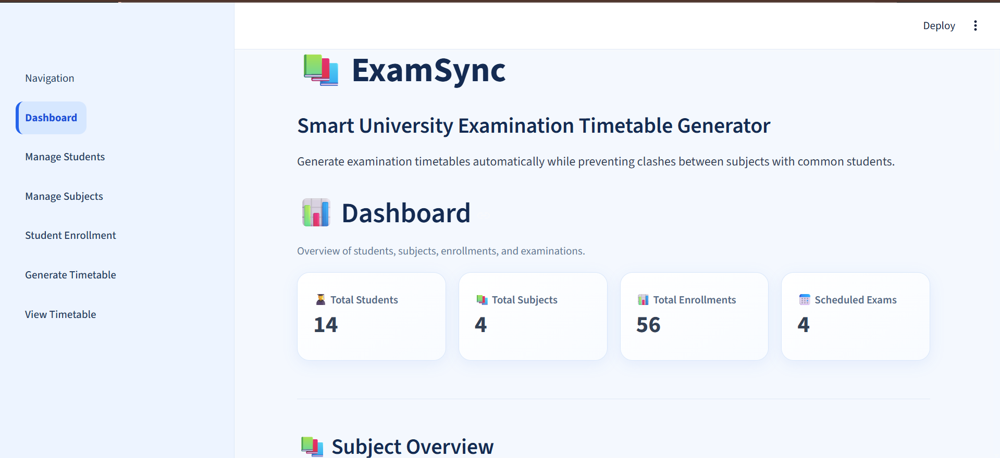
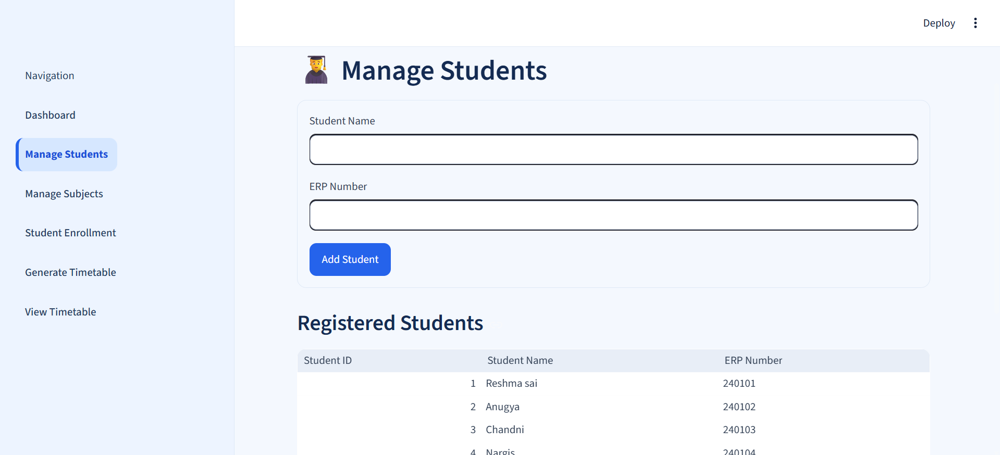
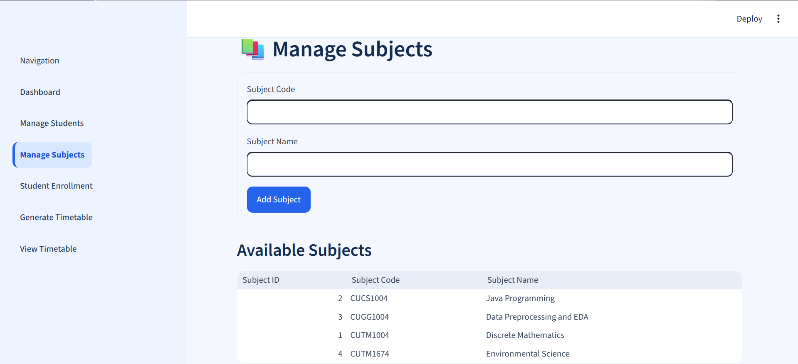
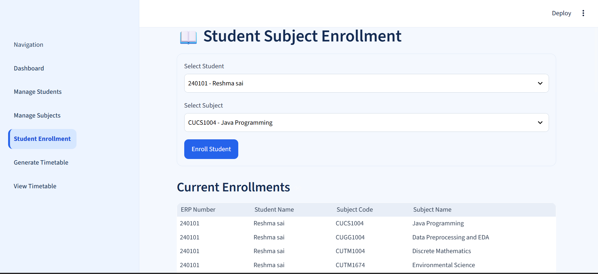
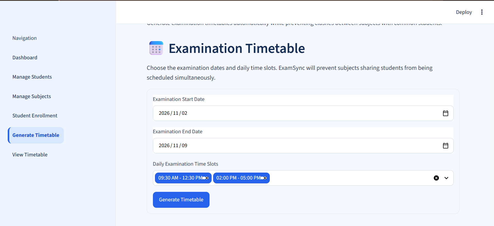
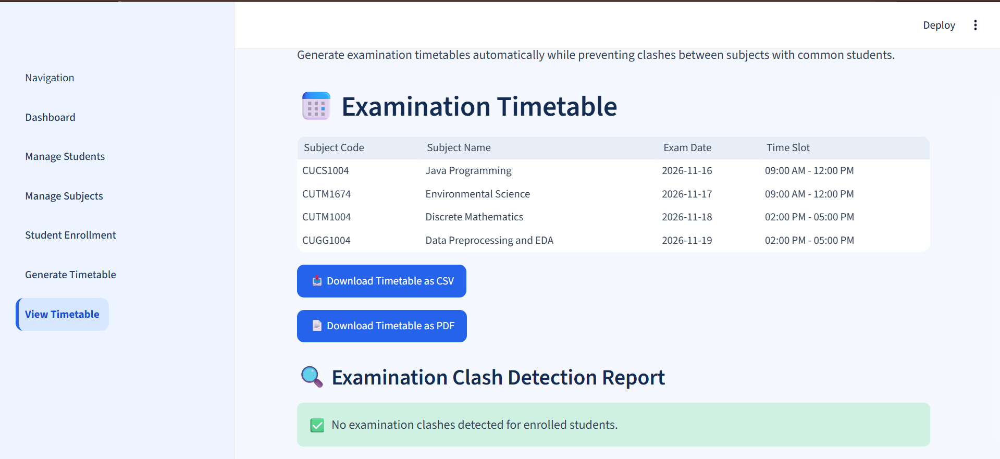

::: {align="center"}
# 📚 ExamSync

### Smart University Examination Timetable Generator

**Generate examination timetables automatically while preventing clashes
between subjects with common students.**

[](https://www.python.org/)
[](https://streamlit.io/)
[](https://www.sqlite.org/)
[]()
:::

------------------------------------------------------------------------

## 📌 Overview

**ExamSync** is a web-based application designed to help universities
organize examination schedules more efficiently. It provides a central
place to manage students, subjects, and student-subject enrollments,
then generate an examination timetable for a selected date range and
daily time slots.

The application is designed to help avoid examination clashes: subjects
that share enrolled students should not be scheduled at the same time.
Users can review the generated timetable, inspect a clash-detection
report, and export the timetable as CSV or PDF.

## ✨ Features

-   **Dashboard:** View summary counts for students, subjects,
    enrollments, and scheduled exams.
-   **Student management:** Register students with their names and ERP
    numbers.
-   **Subject management:** Add and maintain subject codes and subject
    names.
-   **Student enrollment:** Link students to the subjects they take.
-   **Timetable generation:** Choose an examination date range and
    available daily time slots.
-   **Clash prevention:** Check for timetable conflicts involving
    students enrolled in multiple subjects.
-   **Timetable preview:** Review subject codes, subject names,
    examination dates, and time slots.
-   **Export options:** Download the timetable in CSV and PDF formats.
-   **Clean interface:** Light blue-and-white styling with a sidebar for
    navigation.

## 🖥️ Application Screenshots

### 1. Dashboard

The dashboard provides a quick overview of registered students,
subjects, enrollments, and scheduled examinations.



### 2. Manage Students

Register students using their name and ERP number, and view the
registered-student list.



### 3. Manage Subjects

Add subjects using a subject code and subject name, and view the
available subjects.



### 4. Student Enrollment

Select a student and a subject to manage student-subject enrollment
records.



### 5. Generate Timetable

Choose the examination start and end dates, select daily time slots, and
generate a timetable.



### 6. View Timetable and Clash Report

Review the generated timetable, download CSV/PDF copies, and check the
examination clash-detection report.



## 🧰 Technology Stack

  Technology            Purpose
  --------------------- -----------------------------------
  Python                Application logic
  Streamlit             Interactive web interface
  SQLite                Local database storage
  Pandas                Tabular data handling and display
  CSV / PDF libraries   Timetable export

## ⚙️ Getting Started

### Prerequisites

-   Python 3.10 or newer recommended
-   Git (optional, for cloning the repository)
-   A web browser

### 1. Clone the repository

``` bash
git clone https://github.com/nageshwarik15-gif/ExamSync.git
cd ExamSync
```

### 2. Create and activate a virtual environment

**Windows PowerShell**

``` powershell
python -m venv venv
.\venv\Scripts\Activate.ps1
```

If PowerShell blocks activation, you can use Command Prompt instead:

``` bat
venv\Scripts\activate.bat
```

### 3. Install dependencies

``` powershell
python -m pip install -r requirements.txt
```

### 4. Run the application

``` powershell
python -m streamlit run app.py
```

Streamlit will display a local address in the terminal, usually:

``` text
http://localhost:8501
```

Open that address in your browser.

## 🧭 How to Use ExamSync

1.  Open **Manage Students** and add students with their ERP numbers.
2.  Open **Manage Subjects** and add the subjects for the examination
    period.
3.  Open **Student Enrollment** and associate students with the subjects
    they take.
4.  Open **Generate Timetable**, choose the start date, end date, and
    available time slots.
5.  Generate the timetable.
6.  Open **View Timetable** to inspect the schedule and clash-detection
    report.
7.  Download the timetable as CSV or PDF when needed.

## 🗂️ Project Structure

``` text
ExamSync/
├── app.py                 # Streamlit user interface and application flow
├── database.py            # Database operations
├── scheduler.py           # Timetable scheduling logic
├── requirements.txt       # Python dependencies
├── README.md              # Project documentation
├── data/
│   └── examsync.db        # Local SQLite database (if included)
├── .streamlit/
│   └── config.toml        # Streamlit configuration (if included)
└── screenshots/
    ├── 01-dashboard.png
    ├── 02-manage-students.png
    ├── 03-manage-subjects.png
    ├── 04-student-enrollment.png
    ├── 05-generate-timetable.png
    └── 06-view-timetable.png
```

> The exact local files may differ depending on your setup. If the
> database is not included in the repository, the application may create
> or initialize it when started, depending on the database
> initialization code.

## 🧪 Validation

Before committing changes, you can check Python syntax with:

``` powershell
python -m py_compile app.py database.py scheduler.py
```

This checks syntax; it does not replace functional testing of the
application.

## 🚀 Future Improvements

-   Add user authentication and role-based access.
-   Add configurable exam duration, room allocation, and capacity
    constraints.
-   Improve scheduling rules for holidays and institution-specific
    policies.
-   Add automated tests for timetable generation and clash detection.
-   Support database backup and restore.

## 👩‍💻 Author

**NAGESHWARI K**

GitHub: [@nageshwarik15-gif](https://github.com/nageshwarik15-gif)

Project repository:
[ExamSync](https://github.com/nageshwarik15-gif/ExamSync)

------------------------------------------------------------------------

::: {align="center"}
**ExamSync --- making examination scheduling clearer, faster, and more
organized.**
:::
